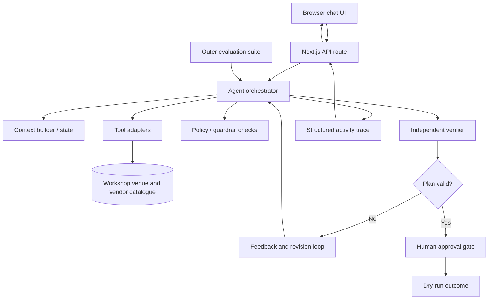

# Gatherly — Agent Engineering Lab

Gatherly is a teaching project for explaining **Harness Engineering** and **Loop Engineering** through a familiar event-planning assistant. It replaces the earlier Jupyter-first implementation with a Vercel-ready Next.js application and an explorable TypeScript codebase.

The same birthday scenario is used throughout the workshop: 40 guests, an indoor family-friendly event in Bengaluru, and a ₹50,000 budget.

## What participants can do

- Chat with the event-planning assistant.
- Switch between **Progressive Build** and **Complete Agent** modes.
- Unlock the agent one building block at a time across 11 stages.
- Inspect tool results, structured plans, policy checks, independent verification, revision history and execution traces.
- Change the requirements conversationally, for example “Make it 60 guests” or “Set the budget to ₹44,000”.
- Approve a dry-run plan without creating a real booking or payment.
- Run the outer evaluation suite against standard, tight-budget, venue-capacity and unsupported-setting scenarios.
- Explore the Architecture and Maintenance Guide pages in the UI.

## Architecture at a glance



More detail is in [`docs/architecture.md`](docs/architecture.md), [`docs/harness-maintenance.md`](docs/harness-maintenance.md), [`docs/loop-engineering.md`](docs/loop-engineering.md), and [`docs/facilitator-guide.md`](docs/facilitator-guide.md).

## Tech stack

- **Next.js 16 App Router** — frontend and server-side API route, deployable to Vercel.
- **React 19 + TypeScript** — typed UI and agent contracts.
- **CSS modules via global CSS** — no UI component library is required.
- **Optional OpenAI Responses API adapter** — server-side narrative generation only. Deterministic code remains authoritative for calculations, policy, verification and approval.
- **Node test runner** — deterministic core tests without requiring an API key.

The workflow is written as an explicit TypeScript state machine instead of depending on an in-memory graph/checkpoint runtime. Vercel Functions can be invoked independently; server process memory is not a reliable place to store a user's long-lived agent state. For this workshop, the browser owns the current event brief and sends it with each request. A production multi-device application should persist state and approvals in a database.

## Run locally

Requirements: Node.js 22 or later and npm.

```bash
cp .env.example .env.local
npm install
npm run dev
```

Open [http://localhost:3000](http://localhost:3000).

By default, `AI_MODE=mock` and the app runs deterministically with no API key. The catalogue is fictional workshop data; no external vendors are contacted.

### Optional live model narrative

Set the following in `.env.local`:

```dotenv
AI_MODE=live
OPENAI_API_KEY=your_server_side_key
OPENAI_MODEL=gpt-6-astra
```

The API key is read only in the server route. Do not add a `NEXT_PUBLIC_` prefix. Live mode lets a model phrase the response naturally, but the structured plan, calculation, policy checks, verifier and approval status continue to come from deterministic TypeScript code. If the model call fails, the deterministic reply is used.

## Useful commands

```bash
npm run dev       # Local development
npm run typecheck # TypeScript validation
npm test          # Deterministic tests
npm run check     # Typecheck + tests
npm run build     # Production build
npm start         # Run production build locally
```

## Deploy to Vercel

1. Push this folder to a Git repository.
2. In Vercel, choose **Add New → Project** and import the repository.
3. Keep the detected framework as **Next.js** and use the default build settings.
4. For the deterministic workshop, no environment variables are required.
5. For live narrative mode, add `AI_MODE=live`, `OPENAI_API_KEY`, and optionally `OPENAI_MODEL` in the Vercel project's Environment Variables.
6. Deploy. Use Preview deployments to review workshop changes before promoting them to Production.

The `vercel.json` file sets the Mumbai region (`bom1`) for the API function to reduce round-trip latency for a workshop run from India. Remove or change this region if your audience or data residency requirements differ.

## Suggested workshop route

1. Start in Stage 1 and run the sample scenario. Ask the audience what is missing.
2. Move through context, tools and output contracts. Keep replaying the same request so each new capability is isolated.
3. Demonstrate the initial ₹61,232 plan against the ₹50,000 budget.
4. Introduce state and change the requirements from chat.
5. Add guardrails and the independent verifier. Make the failed checks visible.
6. Introduce the inner loop. Watch the planner revise against verifier feedback to reach ₹46,824.
7. Show trace events and the human approval gate. Emphasise that approval is a dry run and no booking is created.
8. Switch to Complete Agent and run the outer evaluation suite.
9. Open Architecture and Maintenance Guide so participants can connect UI behaviour to the project structure.

## Important scope and safety boundaries

- All venues, prices and supplier data are synthetic workshop data, not real quotes or availability.
- No booking, message, purchase or payment tool is implemented.
- “Approve dry run” records a demonstration approval only.
- The current event state lives in the browser during a session. It is not durable across browsers/devices or a hard refresh.
- Do not use the workshop as a real event booking or financial planning system without integrating trusted sources, authentication, persistent storage, monitoring, and appropriate controls.

## Project map

```text
app/                       Next.js routes, pages and global styles
  api/agent/route.ts        Request validation and server-side agent entry point
  api/health/route.ts       Health and runtime-mode endpoint
  architecture/page.tsx    In-app architecture explainer
  maintenance/page.tsx      In-app harness/loop maintenance guide
components/                 Chat workspace and reusable UI
lib/
  agent/                    Orchestration, plan builder and feedback loop
  evaluation/               Golden scenarios and outer-loop evaluation
  harness/                  Context/tool contracts, policies, verifier, stages
  llm.ts                    Optional server-side model adapter
  domain.ts                 Shared typed contracts and event state
  harness/stages.ts         Progressive teaching-stage definitions

docs/                       Deeper architecture and facilitator documentation
tests/                      Deterministic tests for core behaviours
```
