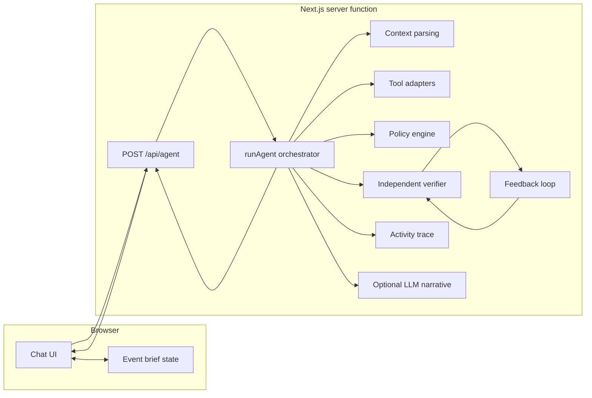
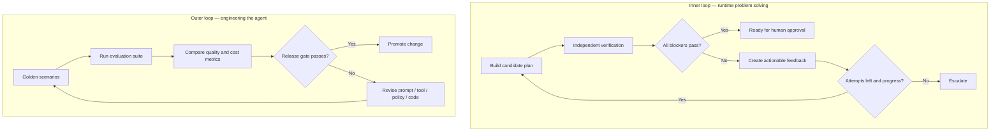

# Architecture guide

## Design goals

Gatherly is both a working chat application and a readable reference implementation. The code is intentionally divided by responsibility so participants can locate each harness and loop element, change it in isolation, and see which tests protect it.

### Runtime architecture

The frontend sends the current brief with every chat turn. This is deliberate: Vercel Functions should be treated as independently invoked compute, not as a persistent process. The server reconstructs the current turn from the request, executes the deterministic graph and returns a structured result.

## Request lifecycle

1. `components/workshop-app.tsx` collects the user's message, selected build stage, mode and current event brief.
2. `app/api/agent/route.ts` validates the request shape and bounds the stage/message size.
3. `lib/agent/run-agent.ts` selects the enabled capabilities for the stage.
4. `lib/harness/tools.ts` returns synthetic venue and vendor catalogue data.
5. `lib/agent/plans.ts` creates typed plan candidates and computes subtotal, tax and contingency.
6. `lib/harness/policies.ts` enforces budget, capacity and no-side-effect policies.
7. `lib/harness/verifier.ts` independently recomputes arithmetic and checks feasibility.
8. `lib/agent/feedback-loop.ts` feeds failed checks back into a bounded revision process.
9. `lib/llm.ts` optionally rephrases the deterministic result with a model. It cannot change verified amounts or status.
10. The API returns plan, checks, trace, iteration history, teaching note and metrics to the UI.

## Harness boundaries

| Responsibility | Module | Why it is separate |
|---|---|---|
| Domain contract | `lib/domain.ts` | Shared types are the interface between the UI and agent. |
| Stage configuration | `lib/harness/stages.ts` | A teaching-stage change should not alter plan math. |
| Tool access | `lib/harness/tools.ts` | Catalogue adapters can be replaced without rewriting the planner. |
| Policies | `lib/harness/policies.ts` | Business constraints must not be prompt-only instructions. |
| Verification | `lib/harness/verifier.ts` | The verifier must be independent from plan generation. |
| State parsing | `lib/agent/run-agent.ts` | State update behaviour has a clear entry point and revision number. |
| Loop | `lib/agent/feedback-loop.ts` | Retry, termination and escalation logic are explicit. |
| Evaluation | `lib/evaluation/scenarios.ts` | Golden cases measure outcomes independently from a live demo. |
| LLM adapter | `lib/llm.ts` | Model-specific integration is replaceable and cannot override controls. |

## Why an explicit TypeScript state machine instead of LangGraph here?

The previous notebook used LangGraph to teach graph nodes and transitions. For a Vercel-first project, this version uses an explicit TypeScript state machine with named modules and a bounded loop. It avoids relying on in-process checkpoint state in a serverless function and keeps the runtime dependency surface small. The transition logic is visible in `run-agent.ts` and `feedback-loop.ts`.

A production implementation can use a graph orchestration library, but it should pair it with a durable checkpointer/store such as Postgres or Redis. The choice of graph library does not remove the need to design state ownership, idempotency, verification, trace retention or evaluation.

## Inner and outer loop

The inner loop solves an individual event plan. The outer loop evaluates whether changes to the agent implementation improve reliability without regressing known scenarios.
